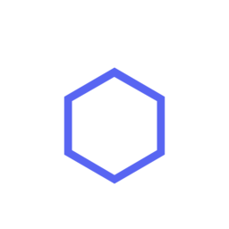
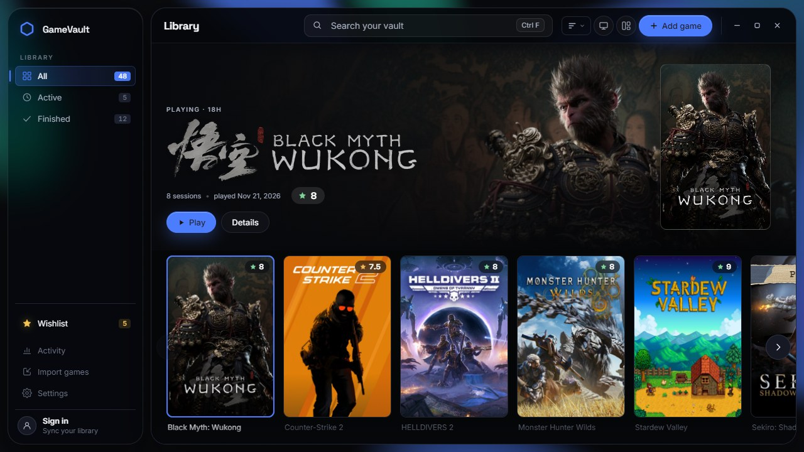
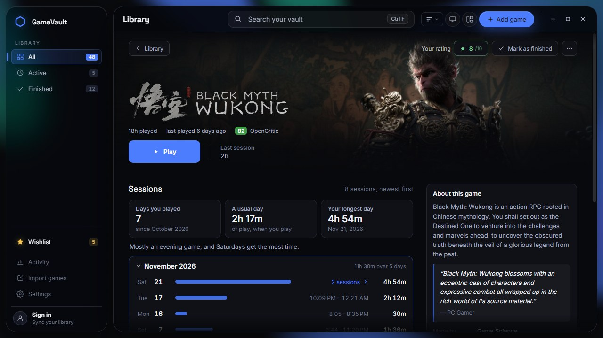

<div align="center">
  
  <h1>GameVault</h1>
  <p><strong>All your PC games in one library. It counts your playtime, launches anything, and works without an account.</strong></p>

  <p>
    <a href="https://github.com/itzSornet/Gamevault/releases/latest"></a>
    
    
  </p>

  
</div>

## What it does

- **One library for every launcher.** Import from Steam, Epic Games, GOG, Xbox and Game Pass, Battle.net, the EA app, Ubisoft Connect, Rockstar, Riot, itch.io, Heroic, Legendary and Hydra, or point it at a folder or a single game file. Turn on sync and new installs show up by themselves.
- **Playtime that counts itself.** GameVault notices when a game runs, even one you started from another launcher, and keeps every session. Time spent away from the keyboard isn't counted.
- **A page for every game.** Your sessions by day, your habits, a short description, critic scores and system requirements. Artwork, logos and banners are filled in for you.
- **Ratings, and your Peak games.** Rate games from 0.1 to 10. A 10 is a Peak: the game's cover gets a torn paper strap in its own colours.
- **A wishlist with prices.** Keep the games you want and see their current price and sales.
- **Screenshots and clips.** Press <kbd>Alt</kbd>+<kbd>Shift</kbd>+<kbd>S</kbd> for a screenshot and <kbd>Alt</kbd>+<kbd>Shift</kbd>+<kbd>R</kbd> to record a clip while you play. They're tagged with the game, along with the ones you take in Steam, NVIDIA or the Xbox Game Bar.
- **Big Picture.** A full-screen mode for the TV, made for a controller. The controller works everywhere else in the app too.
- **Make it yours.** Sidebar, dock, top bar or no navigation at all; colour palettes, your own accent, glass, backgrounds and sizes.
- **Save backups.** Copies of your game saves on your PC, and in the cloud if you sign in.
- **An optional account.** Sign in to sync your library between PCs and back up saves to the cloud. Everything else works without one. See [PRIVACY.md](PRIVACY.md).

<div align="center">
  
</div>

## Install

Download **GameVault Setup** from the [latest release](https://github.com/itzSornet/Gamevault/releases/latest) and run it. GameVault updates itself after that.

Coming from GameVault 1.x? Install over it: your games, playtime, ratings and settings carry over.

Windows 10 and 11. A Linux build will come back in a later update.

## Build from source

You need [Node.js](https://nodejs.org/) 22 or newer.

```bash
git clone https://github.com/itzSornet/Gamevault.git
cd Gamevault
npm install
npm start          # run the app
npm test           # run the tests
npm run build      # build the Windows installer into dist/
```

`cloud/` holds the server side of the optional account (Supabase); see [cloud/SETUP.md](cloud/SETUP.md).

## Where your data lives

Everything is stored on your PC in `%APPDATA%\GameVault`: your library (`games.json`), settings (`config.json`), cached artwork, and your screenshots and clips.

## License

[MIT](LICENSE)
